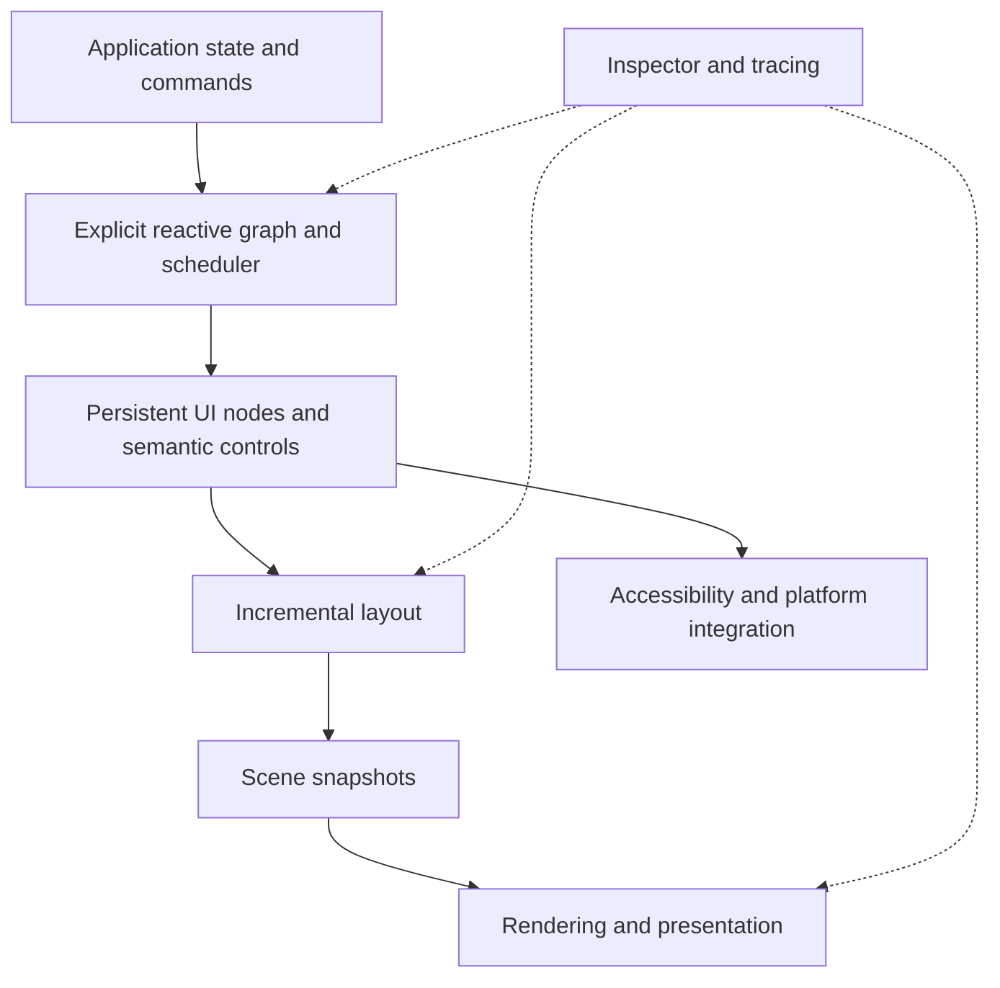

**Aqua — Rust GUI framework working design**

Last updated: 2026-10-25.

This document records the design discussion so far. The framework has no implementation or finalized API yet. All Rust and `ui!` examples are illustrative; they have not been compiled. Product requirements are distinguished from architectural proposals and open decisions.

The companion [reactivity case study](reactivity-case-study.md) contains 60 sourced findings, two additional scheduler reports, and proposed regression scenarios drawn from Svelte and Solid.

**Purpose and constraints**

Build Aqua, a GUI framework implemented in Rust and used from Rust. It should combine productive declarative UI authoring with efficient native execution, extensive customization, and inspectable behavior.

The motivation is dissatisfaction with the baseline cost of browser-based applications, the conceptual surface of mature native toolkits, and the constraints of frameworks closely coupled to one upstream application. These are design motivations, not benchmark conclusions.

The central requirements from the discussion are:

- Rust is both the implementation language and the application language.
- Windows, macOS, and Linux are required desktop targets, with unified application-facing platform APIs.
- Winit and wgpu are the chosen foundations for window/event-loop integration and GPU access, respectively.
- A small visual vocabulary should support application-specific and third-party components.
- HTML's separate tags for similar visual responsibilities should not define the framework's API.
- `Text` should support optional editing; there should not be a separate public `TextEdit` primitive.
- `Media` should cover visual media presentation rather than having an image-only primitive.
- Explore a Rust `ui!` macro for declaring structure and embedding ordinary Rust computations.
- Use a signal-based reactive system inspired by Solid and Svelte.
- Prefer explicit, verifiable reactive behavior even when it requires more code. Agent authoring makes minimizing keystrokes a lower priority.

Native desktop rendering on Windows, macOS, and Linux is required. Minimum OS and GPU versions, mobile support, and browser output remain undecided.

**Framework philosophy: one coherent way, completed properly**

Provide a canonical path for each responsibility: one state model, one component model, one styling model, one public color model, one animation model and one platform-services API. Complete these paths with lifetime, error, accessibility, diagnostics and platform contracts rather than accumulating overlapping alternatives.

Compose capabilities instead of duplicating systems. Normalize external formats at import boundaries. Custom components and renderers use the same public extension contracts as built-in implementations. Keep backend selection and ordinary internal scheduling decisions inside the framework.

Canonical does not mean collapsing distinct responsibilities: flex and grid belong to one layout system; ownership and dependency graphs remain distinct; text editing and text painting share infrastructure but have different lifecycle needs. Prefer a small vocabulary with precise contracts over a universal element with unrelated modes.

When a design must change, use deliberate versioned evolution and migrations rather than permanently maintaining several competing authoring models. User needs, responsiveness, accessibility and portability take precedence over making the internal implementation aesthetically uniform.

**Lessons from browser engineering and GUI theory**

The browser is both a source of mature algorithms and evidence about costly API boundaries. Reuse established semantics where they solve real problems without assuming that HTML/CSS compatibility is a requirement. The following are proposed framework requirements inferred from those lessons.

| Lesson | Evidence / precedent | Proposed consequence |
|---|---|---|
| Performance should scale with affected work | [Chromium rendering priorities](https://www.chromium.org/teams/rendering/) | Track invalidation reasons and affected dependencies; expose actual work in the inspector. A single changed signal is not a guarantee of constant layout cost. |
| Specialized representations serve different jobs | [RenderingNG pipeline](https://developer.chrome.com/docs/chromium/renderingng-architecture) | Use coherent model, semantic, layout and render representations, joined by stable identities. Avoid rebuilding all representations on each update. |
| Latency-sensitive operations need independent progress | [RenderingNG compositor separation](https://developer.chrome.com/docs/chromium/renderingng-architecture) | Keep expensive application work out of input handling. Evaluate independent scrolling/compositor animation with explicit synchronization and viewport constraints. |
| Synchronous geometry queries can force hidden work | [Layout thrashing](https://web.dev/articles/avoid-large-complex-layouts-and-layout-thrashing) | Geometry reads should state whether they return committed layout; any update/measurement checkpoint must be explicit. Avoid read/write cycles that repeatedly force layout. |
| Local optimization needs truthful boundaries | [CSS containment](https://www.w3.org/TR/css-contain-1/) | Support explicit layout/paint boundaries where their sizing and overflow promises hold. Do not assume every component is independently layoutable. |
| Content measurement is fundamental | [CSS intrinsic sizing](https://www.w3.org/TR/css-sizing-3/) | Model intrinsic sizes, baselines, min/max constraints and available space. Preserve useful sizing behavior through text scaling and localization. |
| Semantic behavior is distinct from appearance | [ARIA authoring practices](https://www.w3.org/WAI/ARIA/apg/practices/read-me-first/) | A button behavior must provide activation, focus and accessibility, regardless of visuals. Setting a role alone is insufficient. |
| Editing expresses user intent, not only keystrokes | [Input Events](https://www.w3.org/TR/input-events-2/) | Represent editing operations, selection and composition explicitly. Route keyboard input, paste, IME and accessibility edits through compatible text-model operations. |
| Pointer interaction includes cancellation and capture | [Pointer Events](https://www.w3.org/TR/pointerevents3/) | Support mouse/pen/touch, capture loss and gesture arbitration. A drag must terminate safely when interrupted, its node disappears or focus changes. |
| Overlays need a real composition boundary | [Top layer](https://www.w3.org/TR/css-position-4/#top-layer) | Provide an owned overlay service rather than requiring giant z values. Define stacking, clipping escape, anchoring, dismissal, modality and focus restoration. |
| Group composition is not independent per-child painting | [CSS color and group opacity](https://www.w3.org/TR/css-color-4/) | Isolate groups when necessary. Specify opacity, masks, filters and backdrop dependencies so nested effects compose predictably. |
| A smaller vocabulary must preserve meaning | [Web platform element-purpose principles](https://www.w3.org/TR/design-principles/) | Unify text display/editing where appropriate, but retain heading, list, label and control relationships in semantic data. Do not replace every control with a clickable untyped box. |
| Portable intent is more durable than native API mirroring | [Web platform design principles](https://www.w3.org/TR/design-principles/) | Expose shared operations, capabilities and observed outcomes; keep native handles and OS-specific lifecycle machinery at explicit extension boundaries. |
| Specifications require executable evidence | [Web Platform Tests](https://web-platform-tests.org/) | Build a framework conformance suite across OS/backends. Use deterministic clocks and test geometry, interaction, semantics, visuals, disposal and performance. |

Avoid importing CSS's historical accumulation into the authoring API. Define one property-resolution order, explicit component boundaries, deliberate inheritance and typed units. Final styling syntax is open. Typography and theme propagation are useful; arbitrary global selector coupling should not become the default.

Maintain observable state distinctions. Hidden, clipped, offscreen, paused, disabled, inaccessible and disposed are different conditions. Each has consequences for focus, accessibility, resource lifetime, effects and scheduling. Tests should verify those consequences rather than judging only whether pixels are visible.

Cross-feature behavior is part of every feature's contract. Test blur over a scrolling list or Viewport3D, a menu anchored inside a transformed scroller, an exiting component that owns focus, a font change during editing, and a scale change during animation. A feature is not complete because its isolated demonstration works.

Document explicit properties of the supported layout model instead of accumulating silent quirks. In particular, distinguish border/content sizing, logical/physical dimensions, overflow, stacking and input hit regions. A compatibility importer may translate an external convention, but the core API should retain one meaning.

Take advantage of Rust's versioned dependency model for evolution. Avoid automatic browser-style error recovery in typed authoring APIs when a clear compile-time error is possible. Runtime failures and unsupported native capabilities still require honest results and usable fallbacks.

**Lessons from existing frameworks**

| Framework | Useful ideas | Costs and constraints to examine |
|---|---|---|
| Electron | Fast development loop, application packaging, established web tooling | Browser baseline, application/runtime boundaries, IPC, main-thread bottlenecks |
| Chromium | Rendering stages, incremental updates, independent compositing, excellent inspection | Web compatibility obligations, broad platform scope, coordination between multiple representations |
| Qt Widgets | Mature desktop behaviors, model/view controls, platform integration | Persistent widget/object conventions and a large programming surface |
| Qt Quick | Declarative composition, retained scene data, render-thread separation | Binding costs, object creation, synchronization, and interaction with other Qt programming models |
| GTK 4 | Cached render snapshots, semantic controls, idle-aware frame scheduling | Object-system ceremony, binding conventions, platform-fit decisions |
| GPUI | Hybrid composition, custom elements, focused GPU primitives, explicit state coordination | Framework-specific contexts, upstream-product coupling, independent framework support and stability |
| Dioxus | Rust UI notation, static templates with dynamic slots, authoring tools and hot reload | Its React-like execution model and HTML vocabulary need not become ours |
| Leptos | Targeted reactive updates and a clear distinction between setup and changing computations | Our native runtime and explicit-input policy require their own contracts |

The goal is to borrow specific mechanisms rather than reproduce one existing framework. Mature text input, accessibility, focus, and platform behavior are substantial engineering assets and must be accounted for in any claim of simplicity.

References: [Chromium rendering](https://developer.chrome.com/docs/chromium/renderingng-architecture), [Qt Quick scene graph](https://doc.qt.io/qt-6/qtquick-visualcanvas-scenegraph.html), [GTK drawing model](https://docs.gtk.org/gtk4/drawing-model.html), [GPUI](https://gpui.rs/), [Dioxus templates](https://docs.rs/dioxus-core/latest/dioxus_core/struct.Template.html), [Leptos reactive views](https://book.leptos.dev/view/01_basic_component.html).

**Visual vocabulary**

The current proposed public primitives are:

| Primitive | Responsibility |
|---|---|
| `Box` | Child composition, layout, background, border, clipping, and transforms |
| `Text` | Displayed text, inline styling, optional selection, and optional editing |
| `Media` | Visual assets such as raster images, vector assets, video, and animation |
| `Scroll` | Scrollable viewport, offset, clipping, and scroll interaction |
| `Canvas` | Custom drawing integrated with layout and rendering |
| `Viewport3D` | Programmable GPU-rendered content inside UI layout, capable of hosting game workloads |

This is a proposed public vocabulary, not a promise that the number of internal node types or renderer operations matches the public primitives. New primitives should correspond to distinct responsibilities that cannot be composed cleanly from existing ones.

`Box` fills the role of `div`. Rows, columns, grids, stacks, and flex layouts should be configurations or convenience constructors. They need not become unrelated element families.

`Scroll` currently has explicit primitive status because scrolling combines state, input routing, viewport information, and rendering behavior. Whether it is internally a specialized node or a composition of lower-level facilities remains open.

**Text as one public element**

Headings, paragraphs, labels, and inline text should use `Text`. Their appearance and semantics are properties; separate HTML-like `h1`, `p`, and `span` types are unnecessary.

```rust
// Proposed DSL syntax.
Text("Settings", style: theme.heading)
Text("Choose your preferences.", wrap: true)
```

Inline styling is data within one text layout operation. A styled word should not become a separate flex child: wrapping, baseline alignment, selection, and bidirectional text must continue to work across style boundaries.

Possible representations include styled ranges or a sequence of text runs. Their exact Rust API is unresolved. Accessibility roles such as heading and their associated metadata must be independent of font size or weight.

Editing is an optional capability:

```rust
Text(bind: name, editable: true)
Text(bind: description, editable: true, multiline: true)
Text("Copy this error message", selectable: true)
```

Selection is independent of editing. Enabling editing attaches caret, composition, editing commands, undo, and related state; a static label should not allocate all of that machinery.

A writable model is required for editing. A string literal or an immutable borrowed string must not silently become disconnected internal editable state. A default backing model can be convenient, but its creation and ownership must be explicit.

Single-line versus multiline behavior, wrapping, password masking, validation, and submission policy are separate settings. Avoid one string-valued input type that bundles unrelated behavior together.

The editing backend should allow a text-model abstraction rather than permanently requiring `String`. A small field and a large document can share text infrastructure without sharing every storage or editing policy.

**Media as a shared presentation interface**

`Media` should share sizing, fitting, clipping, asset loading, and presentation concepts across visual media kinds.

Typed sources and capabilities should prevent meaningless combinations: an image source does not gain playback behavior merely because video uses the same public element family.

Audio may share asset and playback infrastructure, but audio itself is not a visual primitive. Playback controls can be components. The exact source, loading-state, and playback APIs remain open.

**Viewport3D: programmable rendering, including games**

Viewport3D must be capable of hosting arbitrary application-defined 3D rendering and game workloads. It must not be limited to model previews, a fixed material vocabulary, a fixed scene format, or one built-in lighting pipeline. Programmability here means an open rendering and execution contract within the capabilities of the selected GPU and backend; it does not promise unsupported GPU features or unlimited resources.

Separate the viewport from a scene engine. A model loader supplies geometry, materials and optional animation data. A scene subsystem manages objects, transforms, cameras and lights. A renderer implements visibility, shading, depth and other passes. Viewport3D integrates the rendered output with layout, composition, input and scheduling. One scene can have multiple viewport instances and cameras.

A built-in scene renderer may offer a convenient default, but applications must be able to provide their own renderer or adapt another engine through the same public extension contract. Model-loading formats and a default 3D engine remain undecided.

Required extension capabilities include:

- Access to the relevant wgpu device/queue and documented resource-sharing boundaries, without requiring a private framework fork.
- User-defined buffers, textures, pipelines, shaders, render passes and compute passes within negotiated device features and limits.
- Multi-pass rendering, depth/stencil targets, intermediate targets and persistent resources with explicit lifetime rules.
- Resize, scale-change, surface/device-loss and resource-recreation notifications.
- Rendering into a compatible output target or producing a compatible texture for UI composition, with submission order and synchronization defined by the framework contract.
- A scheduling policy that allows on-demand frames or continuous animation while preserving bounded work and frame queues.
- Focus-scoped keyboard/pointer input, pointer capture and capability-dependent relative-pointer or cursor-confinement facilities.
- An application update loop that can use fixed simulation steps independently of render cadence, with explicit overload and pause policies.
- Stable layout, clipping, transforms, opacity and stacking behavior, including ordinary UI overlays above a viewport.

Render-to-texture is the initial composition strategy to evaluate. The viewport's output must specify format, color space, alpha convention, size and sample/resolve requirements. Direct shared-target rendering may be a later optimization where it preserves those semantics. Arbitrary GPU passes are an extension facility; they must not silently corrupt framework-owned resources or invalidate resource-lifetime assumptions.

Simulation should not depend on a reactive UI effect running once per frame. An embedded game can update and render without rebuilding its surrounding UI; selected game state can be published into signals at deliberate boundaries. CPU-heavy work should run outside latency-sensitive UI callbacks, and the framework should not wait synchronously for GPU completion during ordinary input handling.

This requirement makes the viewport an engine-hosting boundary, not a requirement that the GUI framework itself supply physics, collision detection, audio, networking, an entity-component system or an editor. These systems can be application code or optional libraries. Accessibility and keyboard navigation for content within a custom viewport require explicit semantic integration supplied by the renderer/application.

Acceptance scenarios include two independent animated viewports, a custom multi-pass renderer, UI overlays and focus transfer, a fixed-step simulation under fluctuating render cadence, resource cleanup after removal, and recovery after resize/device loss. Custom rendering and built-in rendering must use public contracts with equivalent lifecycle guarantees.

**Behaviors and components**

Visual primitives are only one part of the toolkit. Reusable behaviors provide focus, activation, toggling, range interaction, selection, dragging, and keyboard navigation.

The framework should ship standard components built from those foundations:

| Component | Foundations |
|---|---|
| Button | Box, content, activation behavior, focus and accessibility |
| Checkbox | Visual composition, checked state, toggle behavior |
| Slider | Visual composition, range state, pointer and keyboard interaction |
| Dropdown | Activator, overlay placement, list selection, focus management |
| Tabs | Composition, selection, focus navigation |
| Numeric field | Editable Text, parsing, validation, submission policy |
| Tree or table | Data model, virtualization, navigation, selection, accessibility |

`Button` remains a useful public component even though it is not a unique rendering primitive. Changing its visuals must preserve activation, disabled behavior, keyboard handling, focus, and accessibility.

Third-party components should use the same documented extension points as framework components. Custom visual styling must not require reconstructing standard interaction behavior from scratch.

Overlay placement, focus scopes, virtualization, windows, clipboard, drag-and-drop, native dialogs, and external rendering integration need dedicated contracts. They do not all need additional visual element types.

**Authoring model: Rust with an optional `ui!` DSL**

The current direction is an embedded declarative notation rather than a separate scripting language. Application logic remains Rust. A standalone language would introduce its own runtime, type system, tooling, debugging, and interoperability obligations.

The macro should accept primitives and user-defined components consistently:

```rust
// Proposed structural notation, not valid ordinary Rust syntax.
ui! {
    Box(layout: column, gap: 16) {
        Text("Todo App", style: theme.heading)

        Box(layout: row, gap: 8) {
            Text(
                bind: new_todo,
                editable: true,
                placeholder: "New todo..."
            )

            Button(on_activate: add_todo) {
                Text("Add")
            }
        }
    }
}
```

The macro can parse Rust expressions for property values and explicit Rust blocks for local calculations. Ordinary Rust outside the macro handles setup, functions, commands, and data preparation.

For example, a setup-only expression block could be written as:

```rust
ui! {
    Box(layout: column) {
        {
            let title = format_title(config);
            ui! { Text(title) }
        }
    }
}
```

The nested `ui!` makes the boundary between Rust and the DSL explicit. Whether a nested macro is necessary in the final grammar is unresolved. Bare `Text(...)` inside ordinary Rust is not automatically valid: the Rust constructor API would have to support that syntax explicitly.

Local variables are temporary values, not persistent component state. Creating a binding or inserting an expression does not automatically make it reactive under the proposed explicit-input model.

Conditional and repeated UI are desired features, but their final syntax is open. A mount-only Rust `for` loop and a changing keyed list are different operations. The macro must make their update policy and identity understandable rather than guessing dependencies from arbitrary Rust code.

**What `ui!` generates**

The proposed expansion consists of ordinary Rust calls that describe:

- Static structure and constant properties.
- Dynamic property slots and explicit bindings.
- Component and structural-region creation.
- Owner scopes, event callbacks, and source locations.

A static template plus dynamic-slot representation is worth exploring. A builder expansion is also valid. Both should use the same runtime contracts and normal Rust APIs where practical.

```text
Template:
  Box(column, gap = 12)
    Text("Counter")
    Text(dynamic text slot 0)

Binding:
  slot 0 receives the declared computed label
```

The macro does not directly generate pixels or generally calculate final geometry. Window dimensions, content, font metrics, scaling, and dynamic children require runtime work.

Possible compile-time benefits include constant configuration, structural validation, known child counts, generated wiring, and specialization. These are opportunities to measure, not automatic advantages over equivalent hand-written Rust.

Excessive monomorphization can increase compile times and binary size. Dynamic boundaries may be appropriate for collections and interchangeable components.

**Application and component lifecycle**

The current retained model is: mount a component instance, create its state and bindings, and update affected properties or structural regions afterward. The window runtime owns layout, rendering, and presentation; application code does not manually call `.render()` for each state change.

A required React-style render function that reruns the component body is not the current direction. It remains possible to expose rendering callbacks for specialized content without making them the component state model.

`cx` in earlier examples meant context. Prefer a descriptive `scope` for lifetime-bound state and reactive services. Application and window services should have separate responsibilities.

```rust
// Proposed API shape. Scope, Signal, and Element are not implemented types.
fn counter(scope: &mut Scope) -> Element {
    let count = scope.signal(0);
    let label = scope.derive(count.read_only(), |count| {
        format!("Count: {count}")
    });

    ui! {
        Box(layout: column, gap: 12) {
            Text(value: label)

            Button(on_activate: move |_| {
                count.update(|value| *value += 1);
            }) {
                Text("Increment")
            }
        }
    }
}
```

This assumes handles that can be moved or copied into callbacks while remaining associated with a runtime owner. Whether they are copyable arena handles or cloneable reference-counted handles is unresolved. Capturing a borrowed `&mut Scope` in a long-lived callback is not the intended model.

The application startup API will eventually create a runtime, open a window, and mount a root component with its scope. Exact names and signatures are not yet selected.

**Current reactivity proposal: explicit reactive inputs**

The discussion began with automatic runtime dependency tracking. The latest proposed direction is explicit dependencies, driven by the preference for mechanically inspectable behavior over minimal syntax. This is the working proposal to evaluate, not a performance result or implemented contract.

Dependencies should supply arguments to a computation:

```rust
let total = scope.derive(
    (price.read_only(), quantity.read_only()),
    |(price, quantity)| price * quantity,
);
```

Avoid redundant dependency arrays attached to closures that separately read reactive state:

```rust
// Fragile API shape: tax is read but omitted from the declared graph.
derive((price, quantity), move || {
    price.get() * quantity.get() + tax.get()
});
```

A normal Rust closure can capture additional state. Passing inputs as arguments alone does not prove purity or prevent hidden reactive reads. Enforcement options include capability restrictions, macro validation, and development-time read auditing.

Automatic tracking may serve as a development assertion that compares actual reads with declared dependencies. It would not establish production subscriptions. Intentional snapshot reads need their own explicit policy so the validator can distinguish them from missing dependencies.

**Reactive operation categories**

| Operation | Meaning |
|---|---|
| Ordinary Rust expression | Executes when its containing function or block executes |
| Signal | Writable source state with explicit notification semantics |
| Derived value | Cached computation over declared reactive inputs |
| Binding | Connection from a source/computed value to a UI property |
| Effect | Owned synchronization with external systems using declared inputs |
| Snapshot | Read current state without creating a subscription |
| Lifecycle callback | Setup or destruction associated with mounting |
| Resource | Async work with declared inputs, lifetime, and completion policy |

There should be no empty-dependency-array bailout. Express one-time computation as ordinary Rust and mount-time external setup as a lifecycle operation:

```rust
let title = format_title(config); // one-time ordinary computation
let initial_name = name.snapshot(); // deliberate non-subscribing read

scope.on_mount(|mounted_scope| {
    // Mount-time setup with an explicit cleanup facility.
});
```

Exact cleanup registration syntax is open. The runtime should own subscriptions and release them with their scopes; application authors should not routinely pair subscribe/unsubscribe calls manually.

**Read and write capabilities**

Observation and mutation should be distinct capabilities. Candidate types include `ReadSignal<T>`, writable signal handles, and explicit model lenses.

An editable `Text` receives a writable model. A read-only label can receive a read handle or a constant. Passing a computed value does not automatically grant authority to mutate its inputs.

The input representation delivered to computations is unresolved: copying, cloning, borrowed snapshots, and shared immutable values have different costs. Runtime storage guards must not remain held while invoking arbitrary callbacks.

**Dynamic dependencies and collections**

Explicit inputs do not require every dependency set to remain fixed forever. Dynamic subscriptions need explicit operators with documented behavior, such as selecting an item by ID and switching observation when that ID changes.

Keyed collections should preserve component identity through insertion, removal, filtering, and reordering. Index identity should be a deliberate alternative for fixed positions.

Collection membership and item fields are separate concerns. A `Signal<Vec<Todo>>` is collection-level state unless field signals, projections, or an instrumented store provide finer granularity. Arbitrary `&mut Todo` mutation does not disclose which field changed.

The todo example therefore needs contracts for:

- Stable todo IDs and keyed row scopes.
- Writable projections for text and completion state.
- Collection insert/remove notifications.
- A derived total count.
- Selection and editing state surviving reorderings.

These contracts should precede a polished whole-app syntax example; earlier sketches using an ordinary `todos.iter()` should not be interpreted as a finalized reactive-list implementation.

**Scheduling contract to define**

Signal writes, computed reads, observer delivery, UI commits, layout, and frame presentation are separate operations. Candidate behavior is immediate source writes, fresh computed reads, observers queued to an update boundary, and separately coalesced frames.

That policy requires validation. Batching is not automatically a transaction with snapshot isolation, rollback, or atomic visibility across all readers. Lossless events must remain separate from coalesced state observation.

Derived computations should start pure and read-only. Effects should primarily synchronize external systems rather than copy computed values into other signals. Cycle detection must produce useful diagnostics.

Eager versus lazy derived evaluation remains open. Unused expensive calculations favor laziness; resource startup and boundary coordination can favor eagerness. Benchmark these workloads before choosing a default or multiple explicit policies.

Avoid reentrant synchronous flushing in the first design. Internal commit and cleanup operations must not accidentally inherit a user computation's dependency context.

**Async resources and errors**

Read resource inputs synchronously, then start async work. A resource needs:

- An owner scope.
- Explicit pending, success, and error semantics.
- A generation or equivalent mechanism for obsolete completions.
- A cancellation policy and cleanup behavior.
- A policy for previous successful content while new work is pending.

Discarding an obsolete result is different from cancelling its underlying operation. Already-sent external writes may require serialization or server-side version enforcement; dropping a future is not a general rollback mechanism.

Keep user input, request parameters, and displayed results distinct. A slow search should not force one ambiguous value to represent all three.

Recoverable application errors and Rust panics require separate policies. Failed computations must leave a coherent dependency graph and a defined retry path. Owner, tracking, phase, and batching context should unwind through guards where unwinding is supported.

Speculative graph forks are deferred. They introduce versioned caches, multiple states, cancellation, and commit-order obligations that ordinary background tasks do not require.

**Runtime architecture proposal**



These are logical boundaries, not a requirement for one thread per box. The initial graph should run on a defined UI executor, with workers returning messages/results. Cross-thread handles and `Send`/`Sync` guarantees need explicit design.

The renderer should consume a coherent scene representation instead of reading mutable application objects arbitrarily. Queued work and frames need bounds so throughput does not accumulate input latency.

Changes should invalidate the work they affect: a color change normally affects paint; text may affect measurement and layout; certain transforms may take a cheaper rendering path. Exact propagation depends on layout and renderer design.

Text shaping, bidirectional layout, font fallback, IME composition, caret geometry, selection, accessibility, and platform conventions are core infrastructure. A small public API does not eliminate those requirements.

The following platform and renderer strategy is proposed. Taffy is the recommended layout dependency, pending adoption. Text engine, storage scheme, and exact platform implementation dependencies remain undecided.

**Performance architecture: avoid unnecessary frames and work**

The user reports that their optimized GPUI fork still consumes more CPU/GPU during rendering than comparable Chromium applications. This is an important design input, not a controlled benchmark or a diagnosis of the fork. Rust, native APIs, signals and wgpu do not by themselves establish rendering efficiency.

Distinguish display refresh, application frame production, rasterization and composition. A visible static window can reuse its previously submitted surface through the OS compositor without application rendering every refresh. A refresh-rate cap limits frame frequency; it does not remove unnecessary work inside a frame. Rounded utilization figures are not per-frame timings, and Chromium comparisons must include the renderer and GPU processes as well as the browser process.

[RenderingNG](https://developer.chrome.com/docs/chromium/renderingng-architecture) can skip layout and paint for eligible scrolling and visual-effect animations, using its compositor independently of the application main thread. This is conditional on content and effects. Aqua should provide equivalent architectural opportunities rather than promise that every animation is cheap.

[Chromium's compositor](https://chromium.googlesource.com/chromium/src/+/main/cc/README.md) distinguishes content invalidation requiring rasterization from final-frame damage requiring composition. Moving existing content can cause damage without changing its rasterized contents. Aqua should retain that distinction in its scene/effect representation.

Proposed requirements:

- Idle windows schedule no application frames unless animation, media, platform exposure/recovery or another explicit reason requires them. Record the reason for each requested frame. Do not equate a display callback with mandatory rendering.
- Stable UI and scene identity permit targeted updates. Retained drawing commands save command construction; retained pixels can also save raster work. Neither replaces the other. Avoid rebuilding, reshaping or uploading unchanged content.
- Evaluate a hybrid renderer: direct batched primitives for cheap or frequently changing content, reusable raster tiles/surfaces for expensive stable content, and explicit effect passes. Do not allocate a texture per element. Cache policy is internal and budgeted, with identical public semantics.
- Scrolling can reuse unchanged content and raster newly exposed or invalidated regions. Large scrollable documents need virtualization and bounded visible/near-visible resources; a giant full-document texture is not the solution.
- Propagate damage through effects correctly: a stationary backdrop blur changes when content behind it changes. Include old and new bounds, effect expansion, clips and scale. Surface preservation and partial presentation depend on backend guarantees; dirty rectangles alone do not preserve swapchain contents.
- Bound CPU arenas, glyph/image caches, intermediate targets, upload buffers and in-flight frames. Track live, reserved, cached and pending-release memory separately. Reuse resources only after GPU completion permits it. Coalesce obsolete visual updates without discarding required application events.
- Keep compositor scheduling and eligible motion/scrolling able to progress independently of expensive application work, with coherent scene commits and defined thread ownership. Separate threads are useful only with correct synchronization and evidence of benefit.

A 3840 by 2160 RGBA8 texture contains approximately 31.6 MiB of pixel data before allocation overhead. Multiple full-window effect targets, buffering and higher precision quickly become material. Caching trades memory and bandwidth against repeated work; unrestricted caching is not a performance architecture.

Before selecting the 2D renderer, build matched workloads against Chromium and the user's optimized GPUI fork: idle, caret blink, local hover, dense-text scrolling, streaming text, resize, overlapping backdrop blur and an animated 3D viewport. Match physical resolution, content, scale and visual quality. Measure wakeups, CPU/GPU frame time, input-to-presentation latency, rasterized area, uploads, allocations and memory categories. Record frame-time distributions and missed deadlines, not only FPS or aggregate utilization. No comparative measurements have been performed for Aqua yet.

This begins as compositor, damage, scheduling and resource-budget modules within `aqua-render`, coordinated with `aqua-ui` and platform presentation. It does not require another public rendering API or an additional crate immediately.

**Data locality and incremental work**

Cache-efficient storage is an explicit design requirement, to be validated through profiling. The user confirms their GPUI fork already skips unchanged frames and tracks subsection damage; these features alone do not explain or resolve its reported cost relative to Chromium. Aqua must account for costs before and after rasterization, including traversal, encoding, uploads, effect passes and presentation.

Proposed storage rules:

- Use stable generational handles for identity and compact storage for frequently traversed runtime records. An indirection table can preserve handles when dense storage moves. Component ownership does not require one heap allocation or reference-counted pointer per visual node.
- Separate frequently accessed geometry, flags, revisions and scene references from infrequently accessed callbacks, debug information and optional metadata. Choose arrays of structures, structures of arrays or chunked storage per access pattern; no universal layout is presumed fastest.
- Maintain stage-specific dirty queues/worklists with deduplication, so finding changed work does not require scanning every node. Propagate real dependencies: a local text change can legitimately affect ancestor measurement and sibling placement.
- Keep display data compact and ordered for its consumers. Reuse unchanged draw records and GPU resources; update affected ranges where beneficial. Do not reconstruct a whole upload buffer solely because a small part changed. Preserve painter order and effect dependencies when batching.
- Use reusable scratch storage with explicit growth and retention budgets. Persistent scene records and frame-local data have different lifetimes. Scene commits should share unchanged data or transfer bounded updates rather than deep-clone the full scene every frame.
- Cache derived artifacts only with complete validity keys, including relevant content, font, scale, clip and effect dependencies. Treat invalidation correctness and eviction as part of the cache contract.

Acceptance measurements include allocations, bytes traversed/uploaded, cache-miss profiles where available, and CPU time for a local update as unrelated scene size increases. Strict constant-time updates are not promised where layout or composition dependencies require more work.

**Demand-driven scheduling and configurable frame target**

Applications can configure a frame-rate target at initialization and change it at runtime. Illustrative spelling:

```rust
let mut app = Aqua::new();
app.set_fps_target(60);
// app.set_fps_target(900);
app.run();
```

This API is a requested capability, not implemented Rust. A positive target controls pacing of newly produced visual frames under sustained demand; it does not start a perpetual redraw loop or guarantee that hardware can achieve the target. An unchanged application sleeps even when its target is 900. Default target selection remains open.

Schedule on input, scene damage, animation/media deadlines and platform presentation obligations. Coalesce pending visual changes into the newest coherent frame, preserving required application events. Use deadlines rather than a fixed 60 Hz tick or a busy-wait loop. Under overload, avoid accumulating obsolete frames and bound in-flight GPU resources; a high target must not imply a large frame queue.

Input handling, application state updates and simulation are not restricted to the rendering target. Animation samples use elapsed time; a game can use its own fixed simulation timestep. Presentation backpressure must not block unrelated UI work unnecessarily.

Frame production and physical presentation are separate. A 900 target on a 144 Hz display does not create 900 visible refreshes. Producing frames beyond display cadence requires an explicitly supported presentation policy and may consume resources without visible benefit. Keep presentation policy separate from the numeric target; exact API and platform fallback behavior remain open. Platform expose, resize and recovery obligations must still be serviced correctly.

The inspector should expose requested target, achieved production/presentation rates, frame-request reasons, queue depth, blocked time and missed deadlines. Test idle behavior, runtime target changes, overload recovery, multiple windows and background/occluded windows. GPU surfaces and cache allocations remain bounded regardless of configured target.

**Layout engine recommendation: Taffy**

Use an existing box-layout engine rather than inventing flex or grid algorithms. Flexbox is a layout model; Yoga and Taffy are implementations. [Yoga](https://www.yogalayout.dev/docs/about-yoga) is C++ with a C API and focuses on Flexbox. [Taffy](https://docs.rs/taffy/latest/taffy/) is Rust and implements Flexbox, Grid and Block layout. Taffy is the recommended fit for this Rust framework; no comparative performance claim has been established.

Expose our own typed layout properties rather than requiring applications to manipulate dependency node IDs or use CSS strings. Initially prioritize flex rows/columns, grid, sizing constraints, spacing, alignment and explicit positioning. Enabling a mature algorithm internally does not require exposing every CSS layout behavior publicly. Define the supported subset and defaults deliberately.

Taffy offers a managed tree API and lower-level traits for integration with an existing tree. Prototype with the managed tree if it accelerates development; evaluate the lower-level integration once our node storage and invalidation contracts are clear. The latter transfers storage and cache responsibility to us, so avoiding a second tree is not automatically a net win.

Box layout remains separate from text layout. Provide text and media measurement through the layout integration. Text shaping, wrapping, baselines and caret/selection geometry must use compatible metrics during measurement and final rendering. A change in text, fonts or intrinsic media dimensions must invalidate affected measurements; paint-only changes should not invalidate box geometry.

Layout may request measurements under different constraints. Measurement callbacks should be side-effect-free and must not recreate application state or perform synchronous I/O. Cache by the relevant content/font/style revisions and measurement constraints. Include baseline information where required, and establish a coherent logical-unit and pixel-snapping policy.

Virtualization, scroll interaction, focus, accessibility, popup placement policy and GPU drawing remain framework responsibilities. Specialized editors and virtualized views may supply custom layout/measurement boundaries while reusing the common box algorithms for surrounding UI. Layout invalidation may propagate through ancestors or siblings; field-level reactivity does not guarantee that only one layout node is affected.

Acceptance scenarios: wrapped multilingual text inside flex and grid, intrinsic media size changes, nested min/max constraints, right-to-left content, fractional scaling, editable rows reordered during scrolling, and repeated resizing with warm caches. Benchmark on the supported desktop platforms and verify geometry as well as elapsed time.

**Cross-platform architecture and unified APIs**

Windows, macOS, and Linux must be supported through one application-facing Rust API. Most application components should not contain OS conditionals.

Aqua is one shared codebase with platform adapters, not a family of platform-specific framework implementations. Components, state, styling, layout, text-model operations, motion, scene construction and the shared rendering strategy have one implementation. Platform adapters translate native lifecycle, input, services, accessibility and compositor behavior into shared contracts. Winit supplies the common window/event-loop foundation; the adapters add native integration where needed. Wgpu supplies GPU backends beneath the shared renderer.

Keep OS conditionals at adapter/dependency boundaries. Platform capabilities flow into shared policy and fallback handling instead of branching ordinary components into separate applications. Linux can select Wayland or X11 at runtime where both are enabled; do not assume every adapter choice is compile-time. Use focused service contracts rather than one enormous platform trait, and preserve host thread/lifecycle requirements explicitly.

Run shared conformance scenarios against every adapter and a synthetic/headless host where applicable. Fix common behavior in shared code; use adapter fixes for native translation and capability differences. Platform-specific APIs remain explicit extensions, not divergent copies of the normal API.

Separate the implementation into shared UI/runtime code, platform services, a shared 2D renderer, and GPU access/presentation. Window-system integration and GPU API selection are related at the surface boundary, but they are different abstractions.

| Layer | Shared responsibility | Platform-dependent responsibility |
|---|---|---|
| Application/runtime | State, components, commands, dependency graph, node identity | Integration with the host event loop and lifecycle |
| Windowing | Window IDs, requests, observed state, scale and size types | Win32, AppKit, Wayland/X11 behavior and native handles |
| Input and editing | Focus, commands, selection, text-model operations | Key translation, IME composition, candidate positioning and host conventions |
| Accessibility | Roles, actions, values, relationships and node identity | Native assistive-technology adapters |
| Desktop services | Clipboard, dialogs, drag-and-drop and application actions | Host APIs, portals, permissions and data formats |
| 2D renderer | Scene processing, clipping, glyph/image resources and drawing strategy | Surface capabilities and optional specialized integration |
| GPU access/presentation | A constrained graphics interface and resource lifecycle | DX12, Metal, Vulkan and presentation behavior |

The backend families are Windows/Win32, macOS/AppKit, and Linux/Wayland plus X11. Treat Wayland and X11 as different backends rather than assuming one Linux behavior. [Winit](https://docs.rs/winit/latest/winit/) is the chosen foundation for windows and event-loop integration, behind framework-owned APIs. Additional platform services and extensions supply functionality beyond winit's scope.

Unified APIs should normalize intent and data while preserving supported differences. Examples of common operations are creating a window, changing its title, requesting redraw, requesting a content size, handling close requests, and observing focus or scale changes.

Window requests and observed state must be distinct. An accepted request does not prove that the compositor or window manager has already applied it. Use events to report the actual resulting size, focus, fullscreen state, and other observable properties.

Avoid silent success for unsupported functionality. Capabilities and operation results should distinguish unsupported requests, rejected or unavailable operations, and accepted requests whose completion is observed later. The exact request/result API is open.

This matters for operations such as global positioning: winit documents window position queries and positioning as unsupported on Wayland. A cross-platform contract cannot promise every platform the same global coordinate controls. [Window platform behavior](https://docs.rs/winit/latest/winit/window/struct.Window.html).

Use typed logical units for application layout and explicit physical pixels at rendering boundaries. Distinguish window-local, content-local, and screen coordinates. Scale changes must invalidate the relevant layout, raster caches, and surfaces without discarding unrelated application state.

Keep host behavior where it matters: application menus, title bars, window controls, shortcut conventions, IME, and accessibility. A shared UI implementation does not require identical platform chrome. Platform-specific extension modules can expose additional functionality without spreading native handles through the portable component API.

The main event loop should live on the main thread as a cross-platform baseline. Background work must communicate through supported wakeups/messages. Rendering should be event-driven while idle, with continuous frame requests only for active animations, media, or other changing content. Winit documents waiting as the power-efficient mode for applications that do not need continuous redraws. [Event-loop integration](https://docs.rs/winit/latest/winit/).

**GPU backend strategy**

Wgpu is the chosen GPU foundation. Implement or adopt a shared 2D renderer above it, with these proposed preferred native backends:

| Target | Preferred GPU backend |
|---|---|
| Windows | Direct3D 12 |
| macOS | Metal |
| Linux | Vulkan |

Wgpu exposes these backends through its Rust API; Vulkan is also available on Windows. The table is a proposed default policy, not a performance ranking. [Wgpu backend features](https://wgpu.rs/doc/wgpu/documentation/features/index.html).

Do not confuse wgpu with our 2D renderer. Wgpu supplies GPU resources, pipelines, command encoding and surfaces. Our renderer, or an adopted 2D engine, still has to implement paths, antialiasing, text/glyph drawing, image sampling, clipping, blending and effects.

Vulkan everywhere would still need a Vulkan implementation layered over Metal on macOS, with portability and presentation considerations. It does not eliminate platform integration. Prefer a direct Metal backend through the common graphics layer unless profiling establishes a reason to choose otherwise. [Vulkan portability](https://www.vulkan.org/porting).

Writing our own DX12, Metal and Vulkan backend implementations offers additional control but also makes us responsible for their synchronization, allocation, resource transitions, shader translation and driver behavior. Direct3D 12 explicitly assigns synchronization and resource-lifetime duties to applications. [Microsoft's responsibility model](https://learn.microsoft.com/en-us/windows/win32/direct3d12/important-changes-from-directx-11-to-directx-12).

Start with a small number of useful boundaries rather than prebuilding a second general-purpose GPU abstraction over wgpu. Keep public scene and component types independent of backend-native handles; isolate surface/presentation code and any native texture interoperability. Replace or specialize lower-level paths only when measurements or required features justify it.

**2D rendering and presentation requirements**

Evaluate a shared UI renderer focused on rounded rectangles, borders, shadows, glyphs, images and clipping. Glyph/image caches, batching, resource reuse and avoiding unnecessary work are central. General path rendering for Canvas must fit the same ordering, clipping and compositing contract.

The open choice is how much of that renderer to implement ourselves versus adopt. The [Vello renderer family](https://github.com/linebender/vello/releases) is one Rust candidate to evaluate for vector rendering; API stability, visual correctness, cold-start cost, integrated-GPU performance, memory use and external-texture support need measurement. Do not introduce multiple overlapping 2D renderers without a clear benefit and shared semantics.

Presentation remains platform-sensitive even behind a graphics abstraction. Handle resize, scale changes, minimization, occlusion information where available, missing surfaces, device loss, sleep/wake and display changes. Avoid acquiring or configuring zero-sized targets and define resource reconstruction after GPU loss.

Bound frames in flight and tune input latency against throughput. A fixed triple-buffering rule is not sufficient: wgpu describes maximum frame latency as a backend-dependent hint. [Surface configuration](https://docs.rs/wgpu/latest/wgpu/type.SurfaceConfiguration.html).

Metal presentation also interacts with Core Animation transactions, demonstrating why window integration and frame scheduling remain explicit responsibilities. [Apple presentation semantics](https://developer.apple.com/documentation/quartzcore/cametallayer/presentswithtransaction).

Specify premultiplied alpha, color spaces, pixel snapping and surface formats deliberately. External video or custom GPU surfaces require explicit lifetime and synchronization rules. Start with a defined baseline output model; HDR and wide-gamut output are additional capability decisions.

Software rendering fallback, virtual-machine behavior, remote-desktop support, unsupported-adapter diagnostics and GPU feature minimums are unresolved product requirements. The first implementation must at least fail clearly and recover where supported rather than assuming a usable GPU is always present.

**Color model: OKLCH-first authoring with explicit interchange**

The preferred authoring model is OKLCH for theme tokens and perceptual adjustments. Accept user-provided sRGB hex through an explicit parser/conversion API rather than requiring users to convert input themselves. Hexadecimal CSS-style RGB notation specifies sRGB; converting it to OKLCH changes coordinates, not the intended color. Conversion precision and serialization policy still matter. [Color spaces and conversion](https://www.w3.org/TR/css-color/).

Separate input formats, authoring operations, interpolation, GPU working values and display output. An OKLCH-first public API does not imply doing GPU blending or storing media textures in OKLCH. Proposed rendering policy: use a defined linear-light RGB working space with premultiplied alpha for composition, and convert authored colors at appropriate boundaries. Preserve wide-gamut values until an explicit output mapping is required.

Use one public OKLCH color model, including alpha, for authored UI properties. Proposed helpers such as `Oklch::from_hex`, `Oklch::from_srgb8` and `Oklch::from_hsl` convert external representations into this model; they do not introduce alternative property formats. Define RGB encoding/ranges and the HSL convention explicitly. Exact names and internal storage remain unresolved. If exact user input must be editable or round-tripped, preserve its original representation alongside the normalized color. Do not repeatedly quantize through 8-bit hex.

Theme derivation can adjust OKLCH lightness, chroma and hue. Choose interpolation separately: OKLab and OKLCH have different hue/chroma behavior, so the gradient/animation policy needs explicit defaults, hue-path handling and alpha rules. Do not assume perceptual lightness alone establishes accessible contrast.

Acceptance scenarios: user-entered hex remains visually consistent after conversion; malformed input returns a parse error; translucent gradients have no dark fringes; neutral colors avoid arbitrary hue jumps; wide-gamut tokens receive deliberate output gamut mapping; and media/3D content composes consistently with UI colors.

**Animation: one native public model**

The framework must offer one coherent animation model and authoring format. Avoid separate competing systems for implicit transitions, keyframes, springs and imported interactive assets. Lottie and Rive are not selected as the core format. Optional future importers must be treated as integration boundaries, with unsupported semantics reported explicitly, rather than expanding the core API into several unrelated animation models.

The working proposal is a typed motion model with explicit targets, property ownership and playback state. Simple state-driven movement and authored sequences should use the same representation and scheduler. Exact timing representation, interpolation policy, physical response parameters and Rust syntax remain open; the user has established the requirement for one model, not selected those details.

Required semantics: retarget from the currently displayed value; preserve velocity where the selected response model defines it; define competing writes to one property; support interruption, cancellation, seeking and completion through a consistent controller; and distinguish application target state from animated presentation state. Do not force applications to choose an unrelated API merely because motion becomes interactive or gains multiple stages.

Motion must integrate with explicit reactive inputs, scoped disposal, enter/exit lifetimes, reduced-motion preferences and the frame scheduler. Define whether a property affects layout or only composition. Imported asset playback and 3D simulation may use their own internal data, but must integrate through declared timing, lifecycle and composition boundaries rather than redefining ordinary UI property animation.

Acceptance scenarios: rapidly reverse a panel mid-motion without a position jump; retarget repeatedly while dragging; cancel or replace a sequence and settle completion correctly; remove its owner; and apply a reduced-motion preference during playback. Ensure a superseded completion callback cannot remove a newly reopened component.

**Visual effects, native materials, and compositing features**

Backdrop blur, frosted windows, and advanced composition are product requirements to design around from the beginning. They must be available through public APIs and extension contracts rather than requiring a framework fork. Their exact API, platform coverage, and implementation milestones remain open.

Keep three effects distinct:

| Effect | Source | Implementation responsibility |
|---|---|---|
| Content filter | An element and its rendered descendants | Our renderer: isolated group, filter passes, then composition |
| In-app backdrop filter | Earlier content behind an element within a defined composition scope | Our renderer: backdrop source, correct ordering, filter passes, clipping and composition |
| Native window material | Content behind the application window, or an OS-provided system material | Platform compositor integration with capabilities and fallback behavior |

Transparency alone does not blur. A self-blur is not a backdrop blur. A native desktop material does not grant our shaders access to other applications' pixels. Desktop capture is a separate feature with its own APIs and permissions; screenshot polling must not be the implementation of ordinary frosted windows.

On macOS, NSVisualEffectView supports behind-window and in-window blending and semantic material roles. AppKit vibrancy is an additional foreground behavior, not an automatic property of custom GPU-drawn text. [Apple visual effects](https://developer.apple.com/documentation/appkit/nsvisualeffectview).

On Windows, Mica and Desktop Acrylic have different sources and appearances: Mica is wallpaper-derived; Desktop Acrylic provides a frosted view behind the window. Integrate through supported native composition APIs appropriate to the chosen OS baseline. Documented DWM system backdrop attributes are one Win32 integration path on supported Windows 11 builds; WinUI examples are not automatically drop-in implementations for a winit/wgpu window. [Windows materials](https://learn.microsoft.com/en-us/windows/apps/develop/ui/materials), [DWM backdrop types](https://learn.microsoft.com/en-us/windows/win32/api/dwmapi/ne-dwmapi-dwm_systembackdrop_type).

On Linux, behind-window blur depends on the display server and compositor protocols. Discover support dynamically; do not treat Linux as one compositor or promise a portable blur radius. The staging ext-background-effect-v1 protocol specifies blur regions and changing compositor capabilities. Existing winit blur support is narrower: its documented Wayland path uses KDE's blur protocol, and its Windows blur method is unsupported. Native adapters may need functionality beyond winit's convenience methods. [Protocol specification rendered from XML](https://wayland.app/protocols/ext-background-effect-v1), [Winit window API](https://docs.rs/winit/latest/winit/window/struct.Window.html).

Window-material APIs should expose semantic intent, actual availability and active fallback. In-app filters can expose numerical parameters such as radius; an OS material should not claim identical numerical effects on every platform. Respond to reduced-transparency/high-contrast preferences, theme and activation changes, and compositor capability changes. Fallbacks must retain readable contrast.

The window backend must support native composition underlays with appropriately transparent GPU content where needed. Establish constraints for multiple effect regions, native layers, child windows, external surfaces, rounded corners and hit testing. A monolithic opaque output surface would block these use cases. Do not promise arbitrary rotations or path masks for native desktop materials unless the platform adapter can implement them.

**Feature roadmap above the small primitive vocabulary**

These capabilities generally belong in properties, behaviors, compositor services or components; they do not each require a new visual primitive. Priorities are an architectural proposal.

| Priority | Capability | Intended use |
|---|---|---|
| Foundation | In-app backdrop blur and content blur as different operations | Frosted panels and filtered content |
| Foundation | Transparent windows and native window materials, with support reporting | Desktop-integrated frosted windows |
| Foundation | Isolated layers, group opacity and correct painter ordering | Nested translucent UI without blending artifacts |
| Foundation | Rounded clipping, nested clips and alpha/path masks | Rounded media, avatars, shaped reveals |
| Foundation | Outer/inset shadows and gradients | Elevation and expressive surfaces |
| Foundation | Public custom effect passes with explicit inputs | User shaders and additional filters without forks |
| Foundation | Transform-aware hit testing and explicit effect bounds | Interactive transformed components |
| Foundation | Popup/overlay placement and native popup integration | Menus, tooltips and unclipped floating UI |
| Foundation | Viewport3D/video/external texture composition under ordinary UI | Effects over games and media |
| Foundation | Incremental damage with backdrop dependencies | Correct updates behind otherwise static effects |
| Early product | Interruptible animations, easing and springs | Fluid UI that reacts immediately to new input |
| Early product | Layout transitions and enter/exit lifetimes | Resizing, rearrangement and removal animations |
| Early product | Reduced-motion/transparency and high-contrast behavior | User-controlled visual accessibility |
| Early product | Virtualized lists, grids, tables and trees | Large data views |
| Early product | Complete editable text, selection, IME, undo and typography | Native-quality fields and documents |
| Early product | Native/custom chrome with drag/resize regions | Custom title bars preserving host behavior |
| Early product | Docking panels, split views and detachable windows | Editors and workspaces |
| Early product | Typed drag-and-drop and clipboard formats | Cross-component and cross-application workflows |
| Early product | Unified focus, shortcuts, accessibility and automation | Reliable keyboard and assistive interaction |
| Early product | Native dialogs, notifications and taskbar/dock integration | Complete desktop applications |
| Later capability | Blend modes, color matrices and displacement filters | Advanced visual composition |
| Later capability | Wide-gamut/HDR rendering with defined color conversion | High-quality media and 3D workflows |
| Later capability | Shared-element transitions across supported surfaces | Spatial continuity between views |
| Later capability | Offscreen rendering, snapshots and export | Thumbnails, previews and automated visual tests |
| Later capability | Opt-in desktop/window capture integration | Capture tools and user-authorized screen workflows |

Path masks, nested effect groups, custom passes and group-opacity behavior are useful acceptance workloads when evaluating an adopted 2D renderer. Avoid selecting a renderer that makes these features require private patches.

**Effect graph and performance contracts**

The renderer needs explicit read/write dependencies between composition passes, independent of application signal subscriptions. A panel can have unchanged state while its backdrop changes because a list scrolls, a video advances or a 3D scene renders behind it. Invalidate the effect output accordingly.

Backdrop sources must exclude the filtered element's own foreground, obey stacking and isolation boundaries, and remain well-defined for overlapping/nested filters. Sampling needs padding beyond the visible clip so blur edges do not become incorrectly dark or sharp. Damage regions must account for the filter footprint, transforms and masks.

Use GPU intermediates and resource pooling with bounded memory. Cache only when source content and effect parameters remain valid. Large kernels, full-window effects and animated backgrounds need measured quality/performance policies; do not hide their cost or force the UI thread to wait for readback.

Custom passes must declare their input textures, output format/size, lifetime, scheduling needs and effect bounds. They should participate in the same composition and damage rules as built-in passes. Native-material coverage belongs in the platform composition model rather than a pretend shader texture.

Acceptance scenarios: a stationary blurred toolbar over scrolling text, blur over video and Viewport3D, two overlapping blur panels, a rounded/masked blur near a window edge, group opacity on overlapping children, fractional-scale resize, native material changes on focus/theme/preference changes, and fallback when the compositor lacks blur. Test visual correctness, input behavior, memory and frame latency.

**Z-order, clipping and overlays**

Simple explicit z-order is a valid Aqua design. Do not adopt CSS's implicit stacking-context triggers merely to support overlays. Ordering, clipping and logical ownership are separate contracts: raising z changes draw order, while leaving a parent's clip requires a different rendering attachment or an explicit clip policy.

For example, a menu owned by a button inside a scroller may render in a window-level host while preserving its originating component's ownership, context and cleanup. Its anchoring uses the committed coordinate transforms and viewport geometry; its drawing order uses Aqua's normal ordering model within that host. An overlay service is lifecycle and placement machinery, not a replacement for understandable z-order or an invitation to invent a second animation/styling system.

The service manages anchor updates, screen-edge placement, dismissal, focus restoration, modality and disposal. Define modality and hit testing independently of visual z: an invisible or fading surface must not accidentally leave the wrong input policy active. Native popups may be necessary to escape the application window itself; moving a node to the root scene only escapes in-window ancestor clipping.

Exact z value type, equal-z ordering, composition-group scope and host API remain open. Avoid promising globally comparable z values across independently composed textures or native windows. An isolated effect group must still compose coherently, and the inspector should explain its ordering boundary.

**Tooling and agent-oriented development**

Explicitness should expose correctness obligations rather than create repetitive bookkeeping. The runtime should generate or manage graph registration, disposal, and valid scheduling from declared inputs and owners.

The inspector should explain:

- Which source and computation caused an update.
- Which UI properties depend on each value.
- Why layout or painting was invalidated.
- Which owner retains a computation, subscription, or task.
- Where a node or binding originated in source.
- Whether work is queued, pending, obsolete, paused, or disposed.

Machine-readable diagnostics and inspectable macro expansion are useful for both agents and humans. They are proposed tooling requirements.

Layout/style/asset hot reload is worth designing around a shared template representation. Arbitrary Rust logic replacement is a separate capability. Reload must preserve or deliberately reset state and clean up replaced subscriptions.

**Verification and initial prototypes**

The first prototypes should exercise an editable multilingual text control, a virtualized variable-height list, and a resizable multiwindow interface. The todo app is useful for authoring ergonomics but does not establish rendering or editing completeness.

Core conformance cases include:

- Declared-input validation and helper-function transparency.
- Dynamic subscription switching and dependency cleanup.
- Diamond-graph consistency, batching, and fresh reads.
- Cycle detection and rejection of writes during derivation.
- Mount/rerun/unmount cleanup with drop and graph counters.
- Failure during graph updates followed by recovery.
- Obsolete async results and completion after owner disposal.
- Stable keyed editing through reorder, filter, and replacement.
- Shared asset caches with independent instance cleanup.
- Expired handles after arena reuse, if arena handles are chosen.
- Inspector neutrality and internal commit isolation.
- UI update, layout completion, and presentation completion as separate events.

See the [case study's acceptance matrix](reactivity-case-study.md) for more detail. These tests have not been implemented.

Measure startup to usable input, total process memory, GPU allocations, input-to-presentation latency, frame-time distribution, idle wakeups, compile time, and visual iteration time. Comparisons need equivalent workloads, assets, builds, and hardware.

**Proposed Cargo workspace**

Aqua is the framework name; `aqua` is its public facade crate. Internal crates are split by responsibility, dependency weight and testability. A crate split is not an invitation to provide competing implementations of the same authoring API.

```text
Cargo.toml
crates/
  aqua/             Public facade, application runtime and integration
  aqua-core/        Shared IDs, geometry, colors, events and scene/semantic data
  aqua-reactive/    Explicit dependency graph, signals, scopes and disposal
  aqua-ui/          Components, persistent UI tree, Taffy integration and motion
  aqua-text/        Text measurement, shaping, editing model and font resources
  aqua-render/      Wgpu integration, 2D rendering, effects and GPU interoperability
  aqua-platform/    Winit, native desktop services and accessibility adapters
  aqua-macros/      ui! parser, validation and Rust code generation
  aqua-3d/          Optional built-in scene/model/rendering facilities
examples/
tests/
docs/
```

This is a target structure for incremental implementation, not a request to scaffold every crate immediately. Do not create an empty 3D engine crate before deciding the default engine strategy. Viewport3D's custom-rendering contract belongs in the UI/render integration and must not require the optional built-in scene engine.

`aqua` owns the application orchestration that joins platform events, explicit update boundaries, UI commits, rendering and presentation. Applications normally depend on it and import its prelude. Internal crates may expose supported extension contracts, but ordinary applications should not need to coordinate their versions or wire them together manually.

`aqua-core` holds small, platform-neutral contract types. It has no winit or wgpu dependency. Scene data references images, glyph/font resources and external surfaces through IDs/descriptors rather than embedding GPU handles. Keep this crate narrowly defined; feature implementations do not belong here merely because several crates use them.

`aqua-reactive` implements source state, declared derived inputs, observer scheduling, ownership and disposal. Its scope services can be tested without a window, layout engine or GPU. Whether its identity types come from core or remain crate-local should follow actual requirements.

`aqua-ui` owns persistent element/component identity, behavior, focus, semantic output, layout invalidation and the Taffy adapter. It consumes text measurement services and produces renderer-neutral scene data. Standard components, typed styles and the one motion model begin as modules here, rather than separate crates with competing lifecycles. It must support headless layout and interaction tests.

`aqua-text` owns shared text/font infrastructure, measurement and editing operations. Platform IME events are translated by the platform layer and applied through this model; native callbacks do not leak into the text model. Text rasterization interfaces and resource descriptors must be designed jointly with rendering so measurement and final pixels agree. The choice of text dependencies is open.

`aqua-render` owns GPU device/resource integration, the shared 2D rendering strategy, effect passes and composition. It consumes core scene data and may use text services for glyph resources. Its public extension module exposes the device/queue and custom-pass contracts required by Viewport3D and third-party renderers. Window acquisition and frame scheduling require cooperation with the app/platform layer, with one defined owner for each resource and queue.

`aqua-platform` owns window/event-loop integration and host services. Organize Windows, macOS, Wayland and X11 adapters as target-selected modules initially. It translates native events to framework types and semantic output to native accessibility APIs. It does not depend on the UI widget implementation or embed a separate rendering engine. Native composition adapters can exchange explicit surface/underlay descriptors with the application integration layer.

`aqua-macros` is a proc-macro crate containing syntax, diagnostics and expansion. Generated code calls documented runtime construction contracts exposed through the facade. The macro crate must not depend on the application runtime or renderer, avoiding a dependency cycle. Extract a parser/tooling crate only once hot reload or formatting actually needs the shared parser.

`aqua-3d`, if implemented, provides the optional default scene renderer and asset integration. It can depend on render's GPU extension contract and core data, but the 2D renderer never depends on the 3D engine. The facade may provide a convenience adapter to the UI viewport.

Proposed normal dependency direction, where A -> B means A depends on B:

```text
aqua          -> ui, platform, render, reactive, text, core, macros
aqua-ui       -> reactive, text, core, taffy
aqua-text     -> core, selected text/font libraries
aqua-render   -> core, text as needed, wgpu, selected 2D engine
aqua-platform -> core, winit, target-specific native libraries
aqua-reactive -> core only if shared contract types are needed
aqua-macros   -> syntax/quote tooling; no runtime dependency
aqua-3d       -> core, render's GPU contract, selected 3D libraries
aqua-core     -> small foundational dependencies only
```

Do not split layout, animation, colors, themes, controls, or individual operating systems into their own crates until independent dependency or ownership needs justify it. Prefer modules for those boundaries initially. Keep backend-native types out of the ordinary component API while explicitly allowing wgpu types at the custom GPU extension boundary.

Cargo features should primarily control substantial optional capabilities such as the default 3D engine or developer tooling. Avoid runtime-model feature combinations that create different rules for signals, color, styling or motion. Select platform dependencies with target configuration and publish a supported baseline per platform.

Testing should follow the boundaries: unit and conformance tests in each crate; cross-crate headless tests for reactive-to-layout-to-scene behavior; desktop integration tests for native events and material composition; and GPU visual tests for effects and external content. Examples are runnable applications, not alternate APIs.

**Open decisions**

| Decision | Current position |
|---|---|
| Public reactive model | Explicit inputs are the latest proposal; prototype and evaluate |
| Undeclared-read enforcement | Capability design and optional development-time auditing |
| Signal lifetime | Scope ownership; handle representation and expired-access behavior unresolved |
| Derived evaluation | Eager/lazy policy unresolved |
| Update timing | Candidate queued observers with fresh reads; precise phase contract unresolved |
| Collection/store model | Explicit granularity and stable identity required; API unresolved |
| Reactive control-flow syntax | Desired; distinguish setup-only Rust from changing structural regions |
| Component properties | Constants, live read inputs, and writable models need typed contracts |
| Box layout engine | Recommended: Taffy; managed tree versus lower-level integration unresolved |
| Text editing models | One public Text primitive; storage and editing backend unresolved |
| Media capabilities | Shared presentation interface with typed sources; API unresolved |
| Required desktop platforms | Windows, macOS, Linux; minimum versions unresolved |
| Platform API | Shared requests/events/capabilities with platform extension points; exact API unresolved |
| Codebase/platform architecture | One shared Aqua implementation with focused platform adapters |
| Z-order and overlays | Simple ordering preferred; clipping/host attachment and overlay lifecycle are explicit, separate contracts |
| Window/event-loop implementation | Chosen: winit behind framework-owned APIs |
| GPU access | Chosen: wgpu; proposed defaults DX12 / Metal / Vulkan by platform |
| 2D renderer | Shared across platforms; custom primitives versus adopted vector engine unresolved |
| 3D integration | Viewport3D must support custom renderers and game workloads; default engine and asset loader unresolved |
| Visual effects/compositor | Backdrop filters, native materials and public custom passes required; renderer and per-platform support matrix unresolved |
| Color model | One public OKLCH model with conversion helpers; storage, interpolation and output policies unresolved |
| Animation model | One native motion format/API required; exact representation and timing semantics unresolved |
| Presentation and fallback | Explicit recovery and frame pacing required; software fallback and feature minimums unresolved |
| Hot reload | Template/assets first; arbitrary Rust code replacement undecided |
| Independent framework maintenance | Stable public extension contracts desired; release policy unresolved |

**Next concrete design step**

Specify scope disposal, signal access, explicit derived inputs, UI bindings, keyed structural regions, and resource completion semantics. Build a small prototype that validates those contracts, then refine `ui!` syntax around demonstrated behavior.
