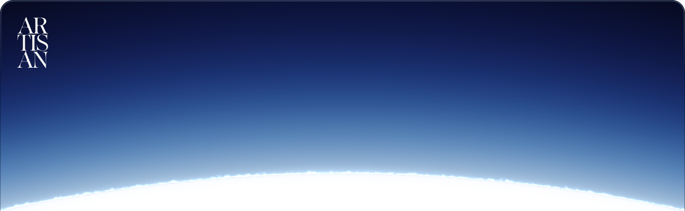

**Aqua by Artisan Street.** A GPU-accelerated GUI framework in Rust. Aqua is a sans-IO based state machine that aims to make developing applications faster and easier.
Native where it counts (text, input, accessibility, windowing), and free to draw whatever you want everywhere else. You're not boxed into WinUI 3's look.

**Verbose, signal based reactivity system.** No implicit subscribes or changes, and every signal needs to declare its dependency array, and the cost of an update is localized.

**A better alternative to keyframes.** Motion is spring curves evaluated on a dedicated render thread, so animations stay smooth even when your app is busy.

**Native text rendering.** Aqua uses the direct text renderer the operating system uses, and ensures you get the best possible rasterized text.

**Sensible defaults.** One way to represent text, one way to represent motion, and one way to represent structure.

**Deterministic all the way down.** The core has no clock, threads or I/O of its own, so any session can be recorded, replayed and compared pixel for pixel.

```rust
use aqua::{Aqua, Context, IntoView, px};

fn counter(cx: &Context) -> impl IntoView {
    let (count, set_count) = cx.scope().signal(0);
    cx.view((count,), move |(count,)| {
        let increment = set_count.clone();
        Aqua::Button()
            .on_activate(move || increment.update(|n| *n += 1))
            .child(Aqua::Text(format!("Clicked {count} times")).build())
            .build()
    })
}

fn main() -> Result<(), aqua::Error> {
    Aqua::App()
        .config(Aqua::Config().window(Aqua::Window().title("Counter").size(px(480.0), px(320.0))))
        .run(counter)
}
```

Aqua is not published on crates.io. You can pin it from this GitHub repository.

---

#### About contributing
We welcome you to open issues for bugs and issues, or feature requests. Pull requests are closed and we do not
accept them from anyone but Artisan Street staff. AI written or assisted issues are welcome.

#### About licensing
Aqua is licensed under [BSD-3](LICENSE).
