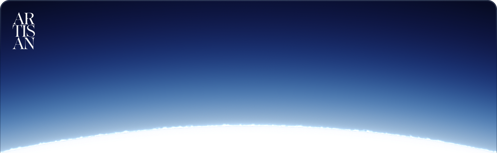

**Aqua by Artisan Street.** A GPU-accelerated GUI framework for Rust, and the foundation [Artisan Editor](https://github.com/artisanstreet/editor) is built on. Aqua splits a UI into a pure, deterministic core (reactivity, layout, styling, text, motion and render planning) and thin platform adapters that drive each operating system's own GPU, windowing, text input and accessibility APIs directly. No webview, and no generic abstraction layer on the hot path.

**Native on every platform.** One codebase runs on Windows, macOS and Linux, and each gets the stack it was built for: Direct3D, Win32, Text Services Framework and UI Automation on Windows; Metal, AppKit, NSTextInputClient and NSAccessibility on macOS; Vulkan, Wayland and X11, IBus and Fcitx, and AT-SPI on Linux. Your app scrolls, types and reads to a screen reader the way the platform expects, because it's the platform doing it.

**Reactivity you can read.** A view declares the signals it depends on. Nothing subscribes implicitly, and nothing re-runs the tree to diff it. When a signal changes, only the views that named it rebuild, and keyed children keep their identity, focus and edit state. The cost of an update follows what changed, not how big the UI is.

**Smooth by construction.** Animation is analytic spring curves evaluated on a dedicated render thread. While something moves, your app code does no work, so a busy main thread never drops a frame, and an idle window is actually idle.

**Text, done properly.** Shaping, bidi, line breaking, rich editing and IME composition, tested against each platform's own text renderer.

**Styled like the web, typed like Rust.** Styles are `const` values that compose field by field. Oklch colour, tokens and themes; flexbox and grid via [Taffy](https://github.com/DioxusLabs/taffy); shadows, backdrop blur and system materials like Mica, Acrylic and vibrancy; and custom GPU passes when that isn't enough.

**Deterministic all the way down.** The core is a sans-IO state machine with no clock, threads or I/O of its own. Any session can be recorded, replayed and compared pixel for pixel against a CPU reference renderer, and the architecture's boundaries are enforced by a crate, not by convention.

```rust
use aqua::{Aqua, Context, IntoView, px};

fn counter(cx: &Context) -> impl IntoView {
    let (count, set_count) = cx.scope().signal(0);
    cx.view((count,), move |(count,)| {
        let increment = set_count.clone();
        Aqua::Button()
            .on_activate(move || increment.update(|n| *n += 1))
            .child(Aqua::Text(format!("Clicked {count} times")).build())
            .build()
    })
}

fn main() -> Result<(), aqua::Error> {
    Aqua::App()
        .config(Aqua::Config().window(Aqua::Window().title("Counter").size(px(480.0), px(320.0))))
        .run(counter)
}
```

Add `aqua = "1"` to your `Cargo.toml` (Rust 1.93 or newer). Run `cargo run -p aqua --example showcase` for the full surface, or `todo` and `collections` with `-- --headless` to watch them run without a display. The guides live in [`docs/`](docs/GETTING_STARTED.md) and the design in [`ARCHITECTURE.md`](ARCHITECTURE.md).

---

#### About contributing
We welcome you to open issues for bugs and issues, or feature requests. Pull requests are closed and we do not
accept them from anyone but Artisan Street staff. AI written or assisted issues are welcome.

#### About licensing
Aqua is licensed under [BSD-3](LICENSE). If your company builds on it, we'd appreciate you reaching out to us first; we're happy to work out an arrangement.
